# ISAT U - DC COFFEE SHOP POS SYSTEM WITH ONLINE RESERVATION AND QR CODE
## Capstone Manuscript (Chapters 1 to 3)

## Chapter I: INTRODUCTION

### Background of the Study

Computers and software are very helpful in running modern stores and coffee shops. In a cafe, a Point of Sale or POS system helps staff take orders quickly, compute prices and discounts correctly, and print customer receipts without making math mistakes. Using Quick Response (QR) codes makes counter work even faster because products and customer passes are identified right away. At the same time, an online booking website helps customers see available seats ahead of time, which prevents long lines and crowded dining areas.

At Iloilo Science and Technology University - Dumangas Campus (ISAT U - DC) in Dumangas, Iloilo, there is an existing Mini Hotel. The school uses this hotel for campus guests, seminars, and student training. The university is now planning to open a new coffee shop and study lounge inside this mini hotel. This new coffee shop will sell coffee, cold drinks, and snacks to students, teachers, and visitors. It will also have tables and quiet study pods with power outlets where students can do their homework and charge their laptops.

To run the upcoming coffee shop efficiently, the operations are divided between two separate staff members: one person works as the cashier at the front counter, and another person works as the barista who prepares the beverages at the kitchen station. However, relying on manual pen-and-paper communication between the cashier and the barista creates serious operational bottlenecks. When the cashier writes orders on loose paper chits and carries or calls them out to the barista, slips can easily get wet, torn, stained by spilled milk, or lost on the prep table. During peak class breaks, verbal shouting and messy handwriting lead to order mix-ups, wrong cup sizes, forgotten modifiers, and delayed service.

To prevent these problems before the coffee shop opens, the researchers created a computerized management system. Setting up a computerized system before opening makes sure the new coffee shop starts with a smooth, paperless, and organized way of working from day one.

The researchers developed the ISAT U - DC Coffee Shop POS System with Online Reservation and QR Code. The system provides dedicated interfaces for each separate user. Customers can visit the website to view seat layouts, reserve study pods with power outlets, select pre-ordered beverages and snacks, and receive an encrypted dynamic QR pass. At the front counter, the cashier uses the touch POS terminal to scan the customer's QR pass, which automatically fetches the pre-order details into the POS cart where items remain fully editable (enabling the customer to modify quantities, change cup sizes, or add new items just like walk-in ordering), calculate statutory discounts, collect cash or GCash payment, and dispatch the confirmed order to the barista Kitchen Display System (KDS). The cashier can also scan printed product QR code tags (via optical camera or 2D scanner) for instant product lookup, verify disposable cup, straw, and takeout box availability before ordering, and print thermal sales receipts without trapping finished products as stocked units. At the beverage preparation area, the barista uses a digital Kitchen Display System (KDS) screen to view incoming paid POS orders alongside each item's exact base recipe ingredients, selected add-ons, and required cups, straws, and takeout boxes—atomically deducting raw ingredients and packaging from the perpetual inventory ledger upon brewing and serving. The system also gives administrators a perpetual inventory suite with datalist-validated Stock In/Out vouchers, item conversions, recipe and add-on configuration, printable menu QR code tag sheets, and sales audit dashboards.

By using this system, the upcoming coffee shop inside the ISAT U - DC Mini Hotel will have an easy and organized way to serve customers, coordinate orders between the cashier and barista seamlessly, manage study pods, and track sales, recipes, packaging, and raw ingredient inventory without using loose paper slips.

### Objectives of the Study

The main objective of the study was to develop and evaluate a Point of Sale (POS) and online reservation system with QR code for the upcoming coffee shop inside the ISAT U - Dumangas Campus Mini Hotel.

Specifically, the study aimed to:

1. Design and develop a centralized database for managing user accounts, products, reservations, orders, payments, and inventory records.
2. Implement role-based access for the administrator, cashier, barista, and customer.
3. Develop an online reservation and pre-ordering portal that allows customers to view availability and receive QR-based booking passes.
4. Develop a POS module that supports product QR code scanning, order processing, payment recording, discount computation, and receipt generation.
5. Develop a Kitchen Display System (KDS) for displaying and updating beverage and food order statuses.
6. Implement inventory monitoring and sales reporting functions.
7. Evaluate the system using the applicable ISO/IEC 25010 software product quality characteristics.

### Conceptual Framework

The conceptual framework of this study was developed using the Input-Process-Output (IPO) model, together with a continuous software quality evaluation feedback loop. Figure 1 shows the conceptual framework of the study.

As shown in Figure 1, the framework illustrates the systematic flow of information through the system for the upcoming coffee shop inside the ISAT U - DC Mini Hotel. The input stage encompasses the baseline data required to initialize and operate the coffee shop: user account credentials for four discrete actors (Administrator, Cashier, Barista, and Customer), product catalog data incorporating two-dimensional (2D) Quick Response (QR) codes for product classification along with selling prices and beverage modifiers, the number of tables and chairs (including dining tables, chairs, and quiet study pods inside the mini hotel), online reservation bookings, and financial transaction parameters (cash tender, GCash references, and discount credentials).

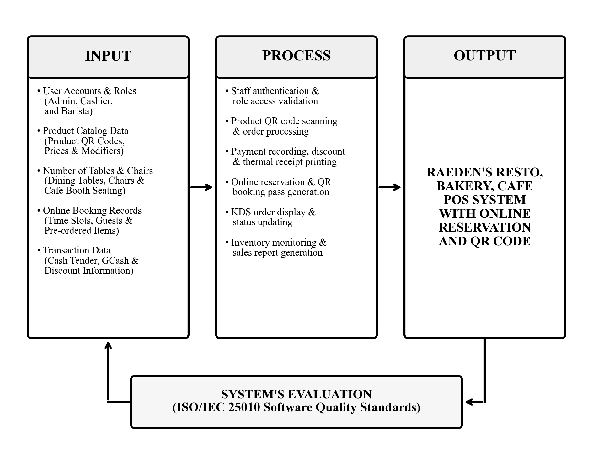
*Figure 1. Conceptual Framework of the Study*

The process stage represents the core functional modules executed by the system: user authentication and role-based access validation, optical QR code auto-reading for product classification, cart calculations with statutory discounting (10% student/faculty and 20% senior/PWD), dynamic customer QR pass token generation, fast counter check-in via QR pass scanning, live electronic order routing to the barista Kitchen Display System (KDS), atomic inventory stock deduction, and sales report logging.

The output stage yields the fully operational ISAT U - DC Coffee Shop POS System with Online Reservation and QR Code. Below the primary processing pipeline, the system's evaluation stage incorporates the ISO/IEC 25010 software product quality standards as a solid feedback loop, providing empirical quality metrics to guide continuous refinement and maintenance of system inputs and operational processes.

### Scope and Limitations

*Scope*

The scope of the study focuses on the design, development, and evaluation of an integrated web-based Point of Sale (POS) and online reservation system engineered specifically for the upcoming coffee shop and study lounge situated inside the ISAT U - Dumangas Campus Mini Hotel in Dumangas, Iloilo. The software encompasses four interconnected functional modules tailored to distinct user roles: an online reservation and pre-ordering portal for customers, a touch-enabled front-counter POS terminal for the cashier, a dark-mode Kitchen Display System (KDS) for the barista, and an administrative control panel for campus supervisors.

The customer portal enables students, faculty, and mini hotel guests to inspect real-time seating availability across designated zones (Lounge, Study Hub, Main Hall, and Terrace), book a study pod or dining table, pre-order customized beverages with specific sweetness and ice modifiers, and receive an encrypted dynamic QR pass for seamless check-in. The front-counter cashier module features optical 2D QR code auto-reading for rapid product classification, cup size and modifier adjustments, statutory discount computation (comprising a 10% discount for ISAT U students and faculty members and a 20% statutory discount for senior citizens and persons with disabilities [PWD]), cash tender and GCash payment recording, thermal receipt generation, and rapid customer QR pass validation. The kitchen operations module provides a dedicated real-time KDS screen with acoustic chimes for beverage and food preparation tracking, and triggers Brew-to-Serve inventory deductions. The administrative module provides user account management, product pricing and recipe configuration, printable menu QR code generation, perpetual inventory tracking, and daily sales auditing.

*Limitations*

The operational scope of the ISAT U - DC Coffee Shop POS System is subject to several practical limitations. First, while the system provides structured recording of digital payments, it does not interface directly with commercial credit card banking gateways; cashless payments conducted via digital wallets such as GCash require manual verification of reference numbers by the counter cashier. Additionally, the system operates as a responsive web-based platform accessible through standard mobile and desktop browsers rather than a native downloadable mobile application, and all booking passes and transactional notifications are delivered digitally through the web portal without automated cellular SMS transmission.

Furthermore, the software is engineered exclusively for on-campus dining, study pod reservations, and counter takeout within the coffee shop and study lounge situated inside the ISAT U - Dumangas Campus Mini Hotel, and does not integrate with external third-party food delivery services or broader multi-branch hotel management infrastructures. Physical access to study pods and reserved tables relies on visual check-in and staff concierge verification rather than automated electronic door latch mechanisms. Finally, system availability depends upon the active campus local area network and continuous institutional electrical power; severe network interruptions or power outages impair real-time portal access until network connectivity is restored.

### Significance of the Study

The development and implementation of this system will benefit various stakeholders of the university:

*Customer (Students, Faculty, and Mini Hotel Guests).* The system provides a self-service web interface to inspect real-time table and study pod availability, reserve study spaces with power outlets, customize beverage pre-orders, and present a digital QR pass for rapid counter check-in without waiting in congested physical queues.

*Cashier.* The system provides a touch-enabled POS terminal equipped with optical 2D QR code auto-reading for rapid product lookup, automated computation of subtotals, statutory discounts, and 12% VAT, and direct issuance of thermal receipts, replacing error-prone manual arithmetic.

*Barista.* The system replaces handwritten paper slips with a paperless, real-time Kitchen Display System (KDS) monitor equipped with audible arrival chimes, exact beverage recipe specifications, modifier instructions, and interactive status buttons to coordinate beverage fulfillment.

*Administrator (Campus Management and Supervisors).* The system provides centralized oversight of user role credentials, product pricing, printable menu QR codes, perpetual inventory balances with automated Brew-to-Serve deduction, and daily sales auditing to support institutional accountability.

*Future Researchers.* The study provides a documented empirical architecture and evaluation reference for designing integrated web and POS applications that combine space reservation, 2D QR matrix classification, and decoupled kitchen-inventory tracking in university auxiliary enterprises.

### Definition of Terms

*Barista*. A skilled beverage preparation specialist responsible for crafting coffee, teas, and specialty drinks. A system user role operating the Kitchen Display System (KDS) interface to view live incoming orders, prepare items according to exact recipe bills of materials (BOM), update ticket statuses, and trigger inventory deduction upon order fulfillment.

*Brew-to-Serve Inventory Deduction*. A perpetual inventory control technique where raw materials and packaging supplies are deducted from stock only when finished products are physically produced and dispensed. An automated system routine executed in the ISAT U system when the barista advances an order from Brewing to Ready/Served, decrementing exact recipe ingredient quantities, cups, straws, and takeout boxes in the database without stock trapping at the POS checkout counter.

*Cashier*. A frontline retail worker responsible for recording customer orders, processing financial transactions, and issuing proof of payment. A system user role accessing the touch POS terminal to scan product QR codes, verify reservation QR passes, compute statutory discounts and taxes, log cash tender or GCash reference numbers, and print thermal receipts.

*Dynamic QR Pass*. A time-sensitive, machine-readable two-dimensional matrix barcode containing encoded transactional or authorization tokens. A cryptographically unique QR code generated by the web reservation portal upon booking confirmation, presented by the customer on a mobile device and scanned by the cashier at the POS terminal to verify seating reservations and auto-fetch pre-ordered items into an editable POS cart.

*Kitchen Display System (KDS)*. A digital kitchen communication monitor that visualizes active culinary orders in real time, replacing physical handwritten chits. A dedicated web-based touch screen interface that renders chronological order cards with countdown timers, audio alert chimes, recipe add-ons, and interactive status buttons for the barista.

*Online Reservation Portal*. A web-based booking system allowing remote users to schedule resource allocation and reserve facilities in advance. The customer-facing web application of the ISAT U coffee shop where users inspect real-time seating availability across four zones, book study pods or dining tables, and select beverage pre-orders.

*Point of Sale (POS) Transaction and Terminal*. The computerized hardware and software environment where a commercial sales transaction is completed, item prices are aggregated, and payments are settled. The dedicated counter terminal interface used by the cashier to process walk-in and pre-order transactions, apply 10% student/faculty and 20% senior/PWD discounts, calculate 12% VAT, and record revenue in the MySQL database.

*QR Code Product Classification and Scanning*. The automated optical identification of retail items using standard 2D matrix symbology (ISO/IEC 18004) to retrieve product attributes without manual typing. The process of tagging coffee shop menu items with unique QR codes, which are decoded by the cashier's optical camera or 2D scanner to automatically populate the POS sales cart with product title, base price, and recipe modifiers.

*Staff Concierge and Seating Grace Period*. A hospitality staff coordination role and policy mechanism managing customer arrival, table allocation, and resource availability. The operations interface and 15-minute grace period policy whereby the staff concierge scans customer QR passes to verify onsite arrival, display assigned table numbers, and monitor unclaimed reservations. If a customer fails to check in within 15 minutes of the scheduled time, the system alerts the staff concierge to forfeit the delinquent reservation and release the table back to available status for walk-in patrons.

*Study Pod*. A semi-private, acoustically buffered individual workspace furnished with electrical outlets and seating for focused academic activity. A designated bookable seating unit within the Study Hub and Lounge zones of the ISAT U Mini Hotel, tracked in the database by unique identifiers, electrical availability, and reservation time slots.

## Chapter II: REVIEW OF RELATED LITERATURE AND STUDIES

This chapter presents a comprehensive review of related literature and published empirical studies that provided the theoretical, conceptual, and technical foundation for the development of the ISAT U - DC Coffee Shop POS System with Online Reservation and QR Code. The first section examines authoritative literature discussing the advanced concepts and technical mechanisms of the system, including transactional data integrity in point of sale architectures, optical 2D matrix symbology, asynchronous kitchen display workflows, facility reservation and space allocation algorithms, role-based access control with separation of duties, and the ISO/IEC 25010 software quality evaluation model. The second section analyzes published empirical research studies, focusing on Philippine university canteen, cafe, and facility reservation implementations. A comparative matrix and synthesis highlighting the functional distinctions of the present study conclude the chapter.

### Related Literature

*ACID Transactional Integrity and Point of Sale Architecture*

Coronel and Morris (2020), in Database Systems: Design, Implementation, & Management (13th ed., Cengage Learning), together with Laudon and Laudon (2022) in Management Information Systems: Managing the Digital Firm (17th ed., Pearson), underscore that enterprise retail and Point of Sale systems fundamentally depend upon the ACID model (Atomicity, Consistency, Isolation, and Durability) to maintain financial and inventory integrity. In multi-user hospitality environments where counter sales, seat bookings, and kitchen orders occur concurrently, atomic transactions guarantee that database operations—such as recording payments, issuing thermal receipts, and executing stock ledger updates—succeed completely or roll back entirely, thereby preventing orphaned records or cash-inventory discrepancies. The ISAT U system adopts this architectural principle by wrapping POS order logging, table occupancy changes, and Brew-to-Serve ingredient deductions in explicit PDO database transactions.

Coronel & Morris, 2020; Laudon & Laudon, 2022

*Role-Based Access Control in Multi-User Service Platforms*

Ferraiolo, Kuhn, and Chandramouli (2020), in Role-Based Access Control (2nd ed., Artech House), emphasize that enterprise information systems serving multiple organizational tiers require strict Role-Based Access Control (RBAC) to enforce the principle of least privilege. Segregating privileges among administrative personnel, frontline service staff, kitchen operators, and external patrons safeguards sensitive business metrics, prevents unauthorized pricing alterations, and provides an auditable operational trail. In the ISAT U coffee shop system, RBAC is strictly enforced via server-side session middleware, ensuring that customers access only public seating and ordering views, cashiers operate restricted sales registers, baristas interact exclusively with kitchen queue controllers, and administrators manage menu pricing, printable QR tags, and inventory parameters.

Ferraiolo, Kuhn, & Chandramouli, 2020

*Two-Dimensional QR Matrix Symbology in Retail and Resource Management*

The International Organization for Standardization and International Electrotechnical Commission (ISO/IEC 18004:2015), along with empirical analysis by Soon (2008), demonstrate that Quick Response (QR) matrix symbology provides significantly superior data density, error correction capability (up to 30% damage tolerance via Reed-Solomon coding), and 360-degree high-speed readability compared to legacy one-dimensional barcodes. These characteristics make QR codes uniquely suited for both mobile customer ticketing and optical retail classification. The ISAT U system leverages ISO/IEC 18004 standards in a dual capacity: generating printable 2D QR tags for instant product classification at the cashier counter, and generating dynamic, encrypted QR passes on customer smartphones for rapid check-in and pre-order retrieval.

ISO/IEC 18004:2015; Soon, 2008

*Kitchen Display Systems and Real-Time Service Queue Coordination*

Davis and Stone (2020), writing in the International Journal of Hospitality Management, demonstrated that transitioning from traditional physical paper chits to digital Kitchen Display Systems (KDS) in commercial food and beverage operations dramatically mitigates order transcription errors, eliminates lost tickets, and reduces ticket fulfillment latency by providing real-time acoustic alerts, color-coded urgency queues, and exact recipe modifier displays. Furthermore, modern KDS architectures allow decoupling POS payment from stock consumption, enabling perpetual inventory deduction only when items are physically prepared and served. The ISAT U system implements this pattern through its dark-mode Barista KDS, which presents incoming order queues with sound chimes, recipe bills of materials, and automated Brew-to-Serve inventory deductions upon drink preparation.

Davis & Stone, 2020

*Prototyping Methodology in Applied Software Engineering*

Pressman and Maxim (2020), in Software Engineering: A Practitioner's Approach (9th ed., McGraw-Hill), assert that the Prototyping SDLC model is the optimal paradigm when developing specialized software from the ground up for novel operational environments where end-user requirements evolve through hands-on interaction. By constructing iterative functional prototypes, presenting them to operational stakeholders, and refining features based on direct user evaluations, development teams eliminate requirements ambiguity and ensure high usability and organizational alignment prior to final campus deployment. This methodology directly guided the phased development of the ISAT U coffee shop system across requirements gathering, quick design, prototyping, evaluation, refinement, testing, and operational deployment.

Pressman & Maxim, 2020

### Related Studies

*Vega & Generoso (2021) — Campus Facility Scheduling*

Vega and Generoso (2021), published in the Asia Pacific Journal of Academic Research in Business Administration, investigated the transition of campus facility scheduling from paper logbooks to an automated web platform at Lyceum of the Philippines University - Batangas. Their empirical findings demonstrated that manual booking caused frequent scheduling collisions and poor administrative visibility, whereas web-based booking eliminated double-bookings and significantly enhanced space utilization across campus facilities. Their study directly informs the study pod and table reservation architecture of the ISAT U system.

Vega & Generoso, 2021

*Intal et al. (2021) — QR Code Table Ordering in Casual Dining*

Intal et al. (2021), published in the International Journal of Research and Innovation in Social Science, developed and evaluated a web-based restaurant management platform incorporating QR code ordering in casual dining establishments in the Philippines. Utilizing the SERVPERF framework, the authors found that digital QR ordering significantly reduced order-taking mistakes and shortened counter checkout delays during operational rush hours. These findings support the optical QR scanning and pre-ordering mechanisms of the ISAT U coffee shop system.

Intal et al., 2021

*Capuyan et al. (2022) — Automated Online Reservation for Campus Hospitality*

Capuyan et al. (2022), published in the International Journal of Advanced Research in Computer Science, designed and evaluated an automated online reservation system for the Cebu Technological University (CTU) Danao Campus Facility Centrum using the Technology Acceptance Model (TAM). Their findings showed that digital reservation management received exceptional acceptance scores from university administrators and guests, eliminating scheduling confusion and providing transparent auditing of hospitality facility usage. Their work reinforces the mini hotel integration implemented in the present study.

Capuyan et al., 2022

*Ramos, Bautista, & Flores (2023) — Automated Ordering and Kitchen Display Queue*

Ramos, Bautista, and Flores (2023) conducted an empirical research study in Western Visayas, Philippines, designing and evaluating a food service management system with an integrated digital kitchen display screen. Their software replaced manual paper slips with a digital order board featuring status stages and sound alerts, achieving an overall composite mean of 4.62 out of 5.0 (Excellent) under ISO/IEC 25010 evaluation among IT specialists and food service staff. Their evaluation methodology and KDS workflow directly guide the barista operations and software quality assessment of the ISAT U system.

Ramos et al., 2023

*Mendoza & Garcia (2022) — Cashless POS and Mobile QR Code Integration*

Mendoza and Garcia (2022), published in the Journal of Philippine Business and Hospitality Management, investigated the operational impact of integrating mobile QR payments (GCash and Maya) alongside cash transactions in micro and small food enterprises in the Philippines. Their survey-based empirical analysis determined that integrating QR e-wallet reference logging directly into POS software reduced cashier cash handling discrepancies by 42% and significantly sped up counter checkout lines. Their findings reinforce the dual payment processing architecture implemented in the ISAT U system.

Mendoza & Garcia, 2022

### Table of Comparison

Table 1. *Comparison of Related Studies with the Proposed System*

| System Feature / Capability | Vega & Generoso (2021) | Intal et al. (2021) | Capuyan et al. (2022) | Ramos et al. (2023) | Mendoza & Garcia (2022) | Proposed ISAT U System |
| --- | --- | --- | --- | --- | --- | --- |
| Centralized Web & POS Database | ✔ | ✔ | ✔ | ✔ | ✔ | ✔ |
| Role-Based Access Control (RBAC) | ✔ | ✔ | ✔ | ✔ | ✔ | ✔ |
| Online Reservation & Seating Availability | ✔ | ✖ | ✔ | ✖ | ✖ | ✔ |
| Dynamic QR-Based Booking Pass | ✖ | ✖ | ✖ | ✖ | ✖ | ✔ |
| Optical 2D QR Code Product Classification | ✖ | ✔ | ✖ | ✖ | ✔ | ✔ |
| Real-Time Kitchen Display System (KDS) | ✖ | ✖ | ✖ | ✔ | ✖ | ✔ |
| Brew-to-Serve Perpetual Inventory Deduction | ✖ | ✖ | ✖ | ✖ | ✖ | ✔ |
| ISO/IEC 25010 Software Quality Evaluation | ✖ | ✖ | ✖ | ✔ | ✖ | ✔ |

### Synthesis of the Study

A rigorous analysis of the reviewed literature and empirical studies reveals a distinct research and operational gap in existing campus commercial platforms. Previous investigations have typically addressed commercial point of sale, facility scheduling, and kitchen management in isolation. Traditional campus retail systems either focus purely on front-counter sales without reservation capabilities, manage room bookings without food and beverage ordering, or lack digital kitchen display coordination. Furthermore, conventional retail POS software enforces counter-level stock trapping, erroneously assuming that finished drinks are pre-manufactured stock units rather than made-to-order artisanal beverages requiring recipe-based preparation. Prior to this research, no documented platform integrated space reservation for quiet study pods with power outlets, optical 2D QR product classification, paperless kitchen queue dispatching, and perpetual recipe-based stock control within a unified campus mini hotel environment.

Methodologically and architecturally, the proposed ISAT U - DC Coffee Shop POS System diverges significantly from previous works. While earlier studies often relied on rigid waterfall models or generic third-party commercial software, this study employs the Prototyping Software Development Life Cycle (SDLC) Model. This iterative methodology enabled continuous design refinement based on hands-on evaluations by university administrators, auxiliary staff, and prospective student patrons. Architecturally, the system decouples sales recording from inventory depletion through an automated 'Brew-to-Serve' mechanism. Frontline cashiers record orders, compute statutory discounts (10% student/faculty and 20% senior/PWD), and issue thermal receipts without altering ingredient balances; raw materials, packaging cups, straws, and takeout boxes are deducted only when the barista physically prepares and serves the order on the KDS screen. Additionally, the system leverages ISO/IEC 18004 2D QR matrix symbology in a unified dual capacity—generating printable menu QR tags for instantaneous cashier cart auto-reading, and issuing encrypted, dynamic QR passes on customer smartphones for rapid concierge check-in and automated loading into an editable POS sales cart.

The primary contribution of this study is the delivery of a customized, cost-effective, and empirically validated operational management prototype developed from the ground up for the upcoming coffee shop inside the ISAT U - Dumangas Campus Mini Hotel. By synthesizing online facility booking, optical QR item scanning, acoustic kitchen signaling, and perpetual ingredient tracking into a responsive Native PHP and MySQL architecture, the system provides a dependable institutional blueprint for university auxiliary enterprises, demonstrating that modern web technologies and 2D matrix symbology can elevate operational efficiency, prevent inventory wastage, and enhance the academic hospitality experience.

## Chapter III: METHODOLOGY

### Project Description

The ISAT U - DC Coffee Shop POS System with Online Reservation and QR Code is an integrated, web-based management platform engineered from the ground up for the upcoming coffee shop and study lounge situated inside the ISAT U - Dumangas Campus Mini Hotel in Dumangas, Iloilo. The system serves as a unified operational bridge connecting front-of-house customer transactions, counter cashiering, kitchen beverage brewing, and back-office administrative oversight.

Through its responsive architecture, customers can access self-service seating reservations across four distinct hotel zones (Lounge, Study Hub, Main Hall, and Terrace), pre-order customized beverages with specific sweetness and ice modifiers, and obtain an encrypted dynamic QR pass for seamless check-in. At the service counter, the cashier operates a touch-enabled POS terminal paired with an optical 2D scanner to read product QR tags for instant classification, apply statutory student, faculty, senior, and PWD discounts, record cash or GCash payments, and print thermal sales receipts. In the beverage preparation area, the barista utilizes a paperless Kitchen Display System (KDS) monitor with audio alert chimes to inspect recipe bills of materials and advance tickets through preparation stages, automatically triggering Brew-to-Serve inventory deductions upon drink fulfillment. Meanwhile, campus administrators utilize centralized dashboards to configure user accounts, adjust menu prices, generate printable product QR tags, monitor perpetual ingredient balances, and audit daily sales revenue.

### Project Development Process

To develop the system from the ground up for the upcoming campus enterprise, the researchers adopted the Prototyping Software Development Life Cycle (SDLC) Model. The Prototyping Model is an iterative software engineering methodology that constructs early functional versions of the system, subjects them to direct stakeholder evaluation, and refines system features through continuous feedback cycles until all operational specifications are fulfilled. This model is exceptionally well-suited for novel campus auxiliary enterprises where end-user requirements and physical workflow configurations evolve through direct operational testing. Figure 2 illustrates the Prototyping SDLC Model implemented in this study.

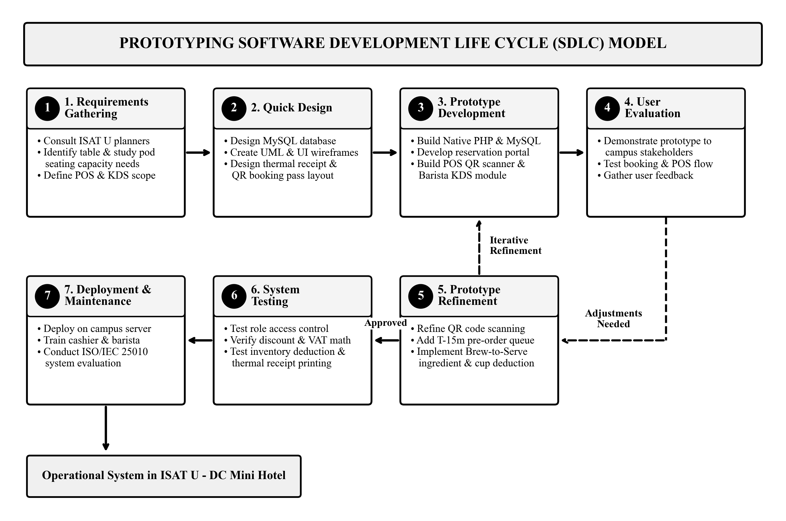
*Figure 2. Prototyping Software Development Life Cycle (SDLC) Model*

*Phase 1: Requirements Gathering*

The researchers consulted with ISAT U - Dumangas Campus administrators, mini hotel supervisors, auxiliary service personnel, and prospective student patrons to establish operational requirements for the forthcoming coffee shop. Key requirements identified included the need for online reservation of tables and quiet study pods with electrical charging outlets, optical QR code product classification at the sales counter, paperless order coordination for the barista, statutory discounting (10% student/faculty and 20% senior/PWD), and perpetual inventory monitoring with low-stock alerts.

*Phase 2: Quick Design*

The researchers formulated the conceptual architecture and database schema in MySQL, created detailed UML structural and behavioral models (System Architecture, Use Case, Activity, Class/ERD, and Sequence diagrams), and drafted user interface wireframes for the touch POS register, the seating floor map, and the barista kitchen screen. Specifications for the thermal receipt and dynamic QR pass layout were finalized during this phase.

*Phase 3: Prototype Development*

A fully functional software prototype was constructed using Native PHP 8.x for server-side business logic and MySQL for relational data storage. Frontend interfaces were built using HTML5, CSS3, JavaScript, and Bootstrap 5.3, incorporating responsive layouts, an HTML5 optical camera and 2D QR barcode scanner, dynamic QR pass generation, and real-time status updating via Fetch API and polling.

*Phase 4: User Evaluation*

The prototype was demonstrated to prospective coffee shop cashiers, baristas, campus supervisors, and student evaluators at ISAT U - DC. Evaluators tested study pod bookings, placed walk-in and pre-orders, scanned product QR codes, processed payments, and updated kitchen tickets, providing critical qualitative feedback regarding usability and interface responsiveness.

*Phase 5: Prototype Refinement*

Based on evaluator feedback, the researchers executed iterative refinements: optimizing camera auto-focus for faster QR decoding, integrating audible alert chimes on the barista KDS screen, adding dedicated 10% student/faculty and 20% senior/PWD discount buttons, implementing POS QR pass scanning for automatic pre-order cart loading with walk-in item editing, establishing the 15-minute seating reservation grace period policy with real-time Staff Concierge alerts for overdue unclaimed tables, empowering the Staff Concierge to forfeit delinquent bookings and release tables to Available status for walk-in guests, and perfecting Brew-to-Serve ingredient deductions upon drink fulfillment.

*Phase 6: System Testing*

Comprehensive unit, integration, and security testing was executed across local network environments. Tests verified the mathematical accuracy of 12% VAT calculations and discount deductions, confirmed atomic transaction integrity across database tables, validated ingredient stock decrements upon order serve, and verified error-free direct thermal receipt printing.

*Phase 7: Deployment and Maintenance*

The completed system was deployed on an institutional web and local area network server at ISAT U - Dumangas Campus. Operational manuals and training orientations were provided to counter cashiers and baristas. Formal software quality evaluation was conducted in accordance with the ISO/IEC 25010 international standard.

### System Architecture and UML Diagrams

*System Architecture*

Figure 3 shows the System Architecture of the application, structured across three operational tiers resting upon a unified institutional infrastructure base:

• Client Tier: Presentation and hardware peripherals layer accommodating four distinct user stations: Customer Smartphone & Laptop (accessing the web booking portal and dynamic QR pass), Cashier POS Terminal (touchscreen terminal paired with a 2D QR scanner and thermal receipt printer), Barista KDS Display Screen (display monitor running the real-time Kitchen Display System), and Administrator PC Workstation (management computer for catalog administration, printable QR code tags, and reporting).

• Application Tier: Network gateway and business logic layer comprising the Wi-Fi Router / LAN Switch (routing local area network traffic) and a Web Server (PHP) executing application modules. Core modules handle role-based access control, online reservations, pre-order scheduling, QR pass tokenization, POS order processing, statutory discount computation, thermal receipt formatting, KDS queue dispatching, and inventory stock deductions.

• Data Tier: Relational database storage layer powered by a Database Server (MySQL), organizing application data across normalized relational tables with transactional integrity, preserving transaction logs, user credentials, recipe bills of materials, and perpetual inventory ledgers.

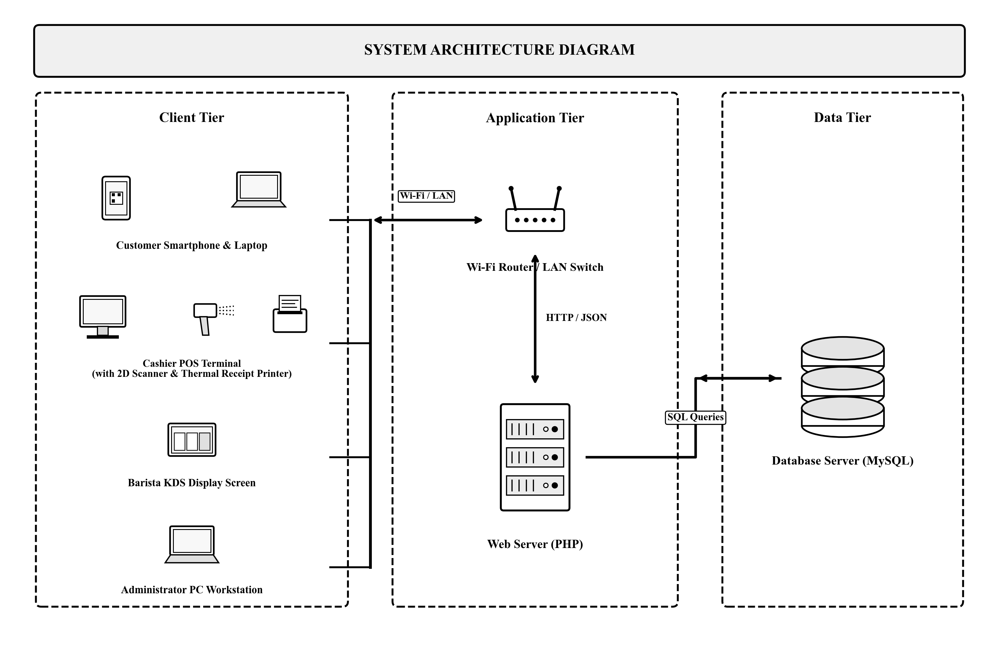
*Figure 3. System Architecture Diagram of the ISAT U - DC Coffee Shop POS System*

*Use Case Diagrams*

To model the functional interactions between the different actors and the system, Unified Modeling Language (UML) Use Case Diagrams were constructed separately for each user role. Each diagram defines the specific subsystem boundary, actor, and operational use cases accessible to that role.

Figure 4a illustrates the Use Case Diagram for the Customer role within the Customer Portal subsystem. The Customer actor interacts with four primary use cases: View Available Tables & Menu (browsing current seating layouts, study pods, and item prices), Reserve Table or Study Pod (selecting desired seating and reservation time slots), Select Beverage Pre-Orders (choosing drinks, cup sizes, and optional modifiers), and Receive QR-Based Booking Pass (generating an encrypted dynamic QR pass for concierge validation).

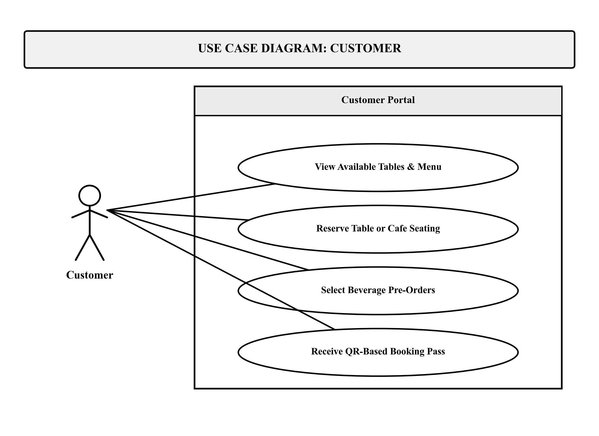
*Figure 4a. Use Case Diagram for Customer Role*

Figure 4b illustrates the Use Case Diagram for the Cashier role within the Point of Sale (POS) Module subsystem. The Cashier actor executes four core operational use cases: Scan Product QR Code (rapid item entry using the 2D barcode scanner), Verify QR Booking Pass (retrieving and confirming customer reservations and pre-orders), Compute Discounts & Total (applying statutory discounts for students, faculty, senior citizens, and PWDs), and Process Payment & Print Receipt (recording cash or GCash tender and generating 58mm thermal sales receipts).

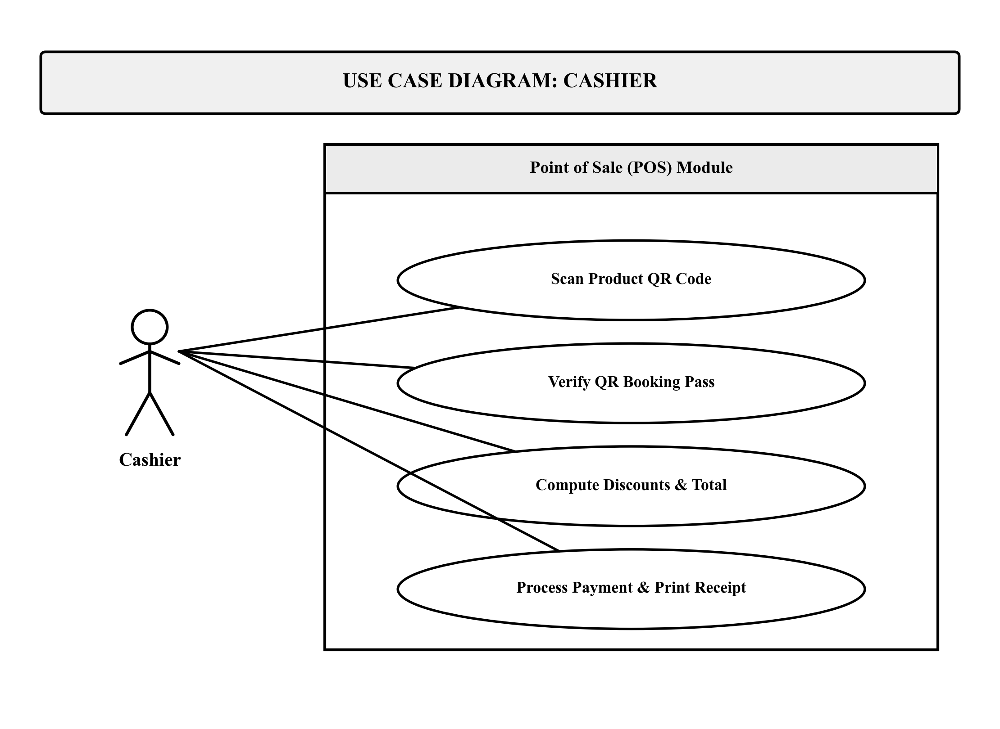
*Figure 4b. Use Case Diagram for Cashier Role*

Figure 4c illustrates the Use Case Diagram for the Barista role within the Kitchen Display System (KDS) subsystem. The Barista actor interacts with four kitchen-centric use cases: View Order Queue on KDS (monitoring incoming orders with color-coded preparation timers), Inspect Recipe & Modifiers (viewing exact bill-of-materials ingredient proportions and cup specifications), Update Preparation Status (advancing orders across Pending, Brewing, Ready, and Served stages), and Trigger Stock Deduction (initiating automated inventory deductions upon drink fulfillment).

*Figure 4c. Use Case Diagram for Barista Role*

Figure 4d illustrates the Use Case Diagram for the Administrator role within the Management Module subsystem. The Administrator actor performs high-level governance through four use cases: Manage User Accounts (creating, updating, and assigning role permissions to staff), Manage Products & QR Codes (maintaining catalog pricing, recipe formulations, and generating printable 2D QR tags), Monitor Inventory Levels (tracking raw ingredient balances, cup stock, and reorder alerts), and Generate Sales Reports (producing daily revenue analytics, VAT summaries, and perpetual inventory audit trails).

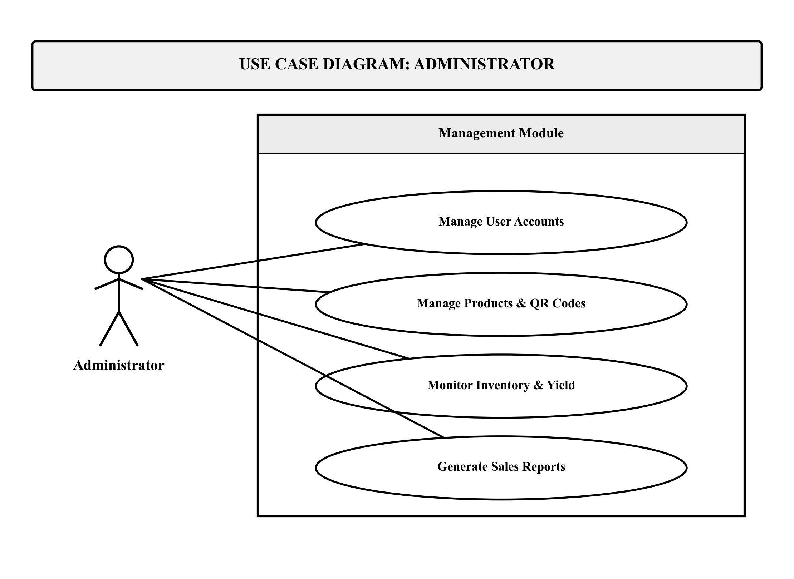
*Figure 4d. Use Case Diagram for Administrator Role*

*Activity Diagrams*

The dynamic operational workflows of the system are modeled using UML Activity Diagrams developed independently for each authorized user role. Modeled after institutional authentication and execution standards, each diagram traces the flow of control from initial user login and authentication through role-specific operational actions to final completion.

Figure 5a illustrates the Activity Diagram for the Customer role. The workflow begins at the solid black Start circle, proceeding into user login and credential authentication. A decision diamond evaluates whether the credentials are valid; invalid attempts loop back to the login prompt, while successful verification directs the user to the Customer Dashboard. From the dashboard, execution forks into parallel activities: browsing menu items and study pod seating layouts, reserving a table or study pod, selecting and customizing beverage pre-orders, and submitting the booking request to receive a dynamic QR booking pass. These parallel streams converge at the synchronization join bar and terminate cleanly at the bullseye final node.

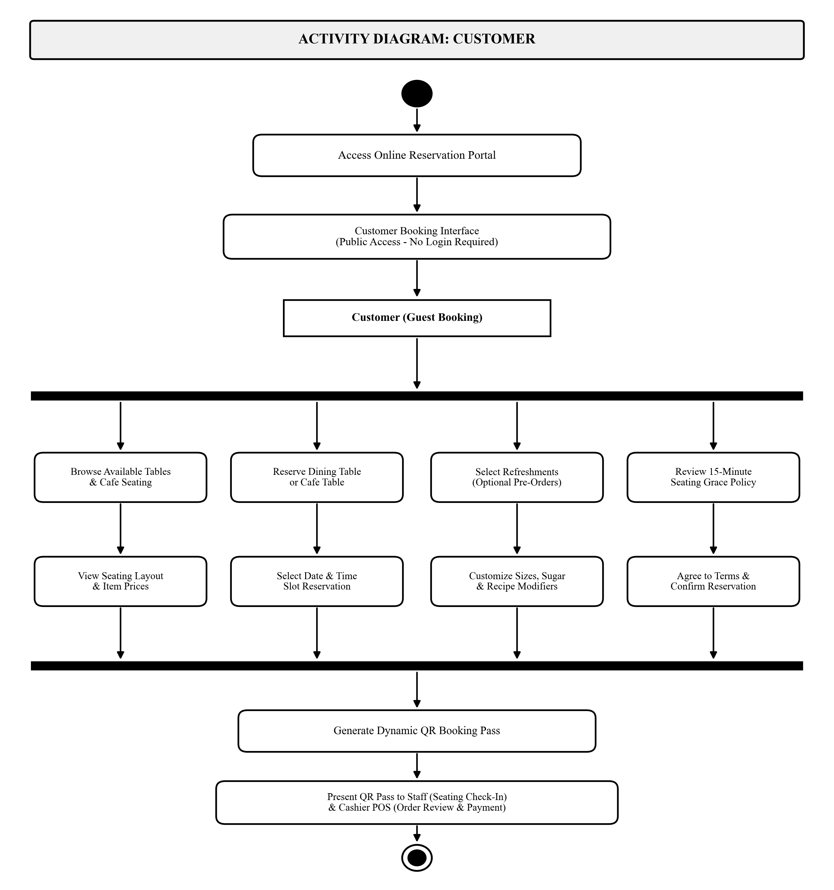
*Figure 5a. Activity Diagram for Customer Role*

Figure 5b illustrates the Activity Diagram for the Cashier role. Following authentication and role validation, the cashier enters the POS Counter Workspace. The execution splits across core transaction activities: scanning product QR codes with the 2D scanner to populate the sales cart, scanning customer QR booking passes to retrieve verified pre-orders, applying statutory discounts (10% student/faculty or 20% senior/PWD) and calculating 12% VAT and net totals, and collecting payment tender (cash or GCash) to print the final thermal receipt. The concurrent activities synchronize at the join bar before reaching the final end node.

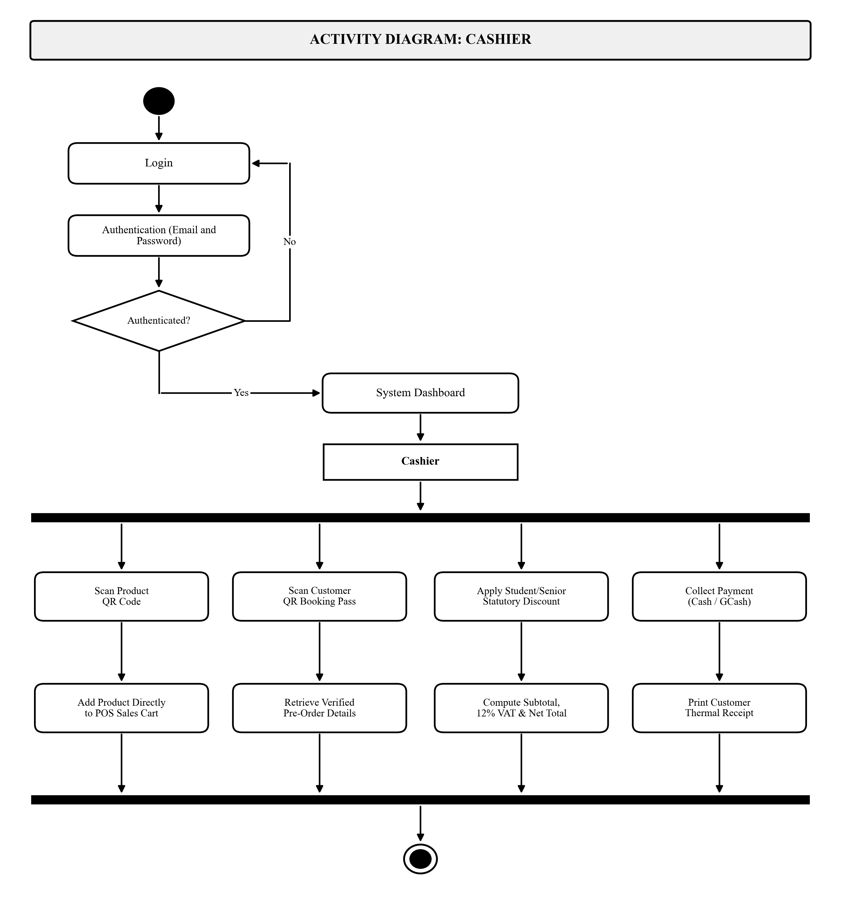
*Figure 5b. Activity Diagram for Cashier Role*

Figure 5c illustrates the Activity Diagram for the Barista role. Upon authentication, the barista accesses the Kitchen Display System (KDS) workspace. Active order tickets arrive on the screen, detailing exact recipe formulations and customer modifiers. The barista marks tickets into the Brewing stage during drink preparation, advances the status to Ready and Served upon completion, and triggers the Brew-to-Serve automated routine to decrement raw ingredient and cup inventory balances. The paths join at the synchronization bar and terminate at the final node.

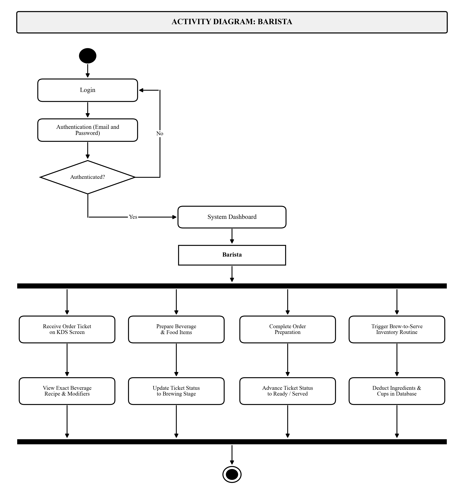
*Figure 5c. Activity Diagram for Barista Role*

Figure 5d illustrates the Activity Diagram for the Administrator role. Following administrative login and authentication, the administrator gains access to the centralized management console. Execution forks into administrative governance streams: managing user accounts and staff role assignments, configuring products and recipes while generating printable 2D QR code menu tags, monitoring perpetual inventory stock balances and recording stock-in deliveries, and auditing financial reports and daily sales revenue. All paths merge at the join bar to terminate at the bullseye final node.

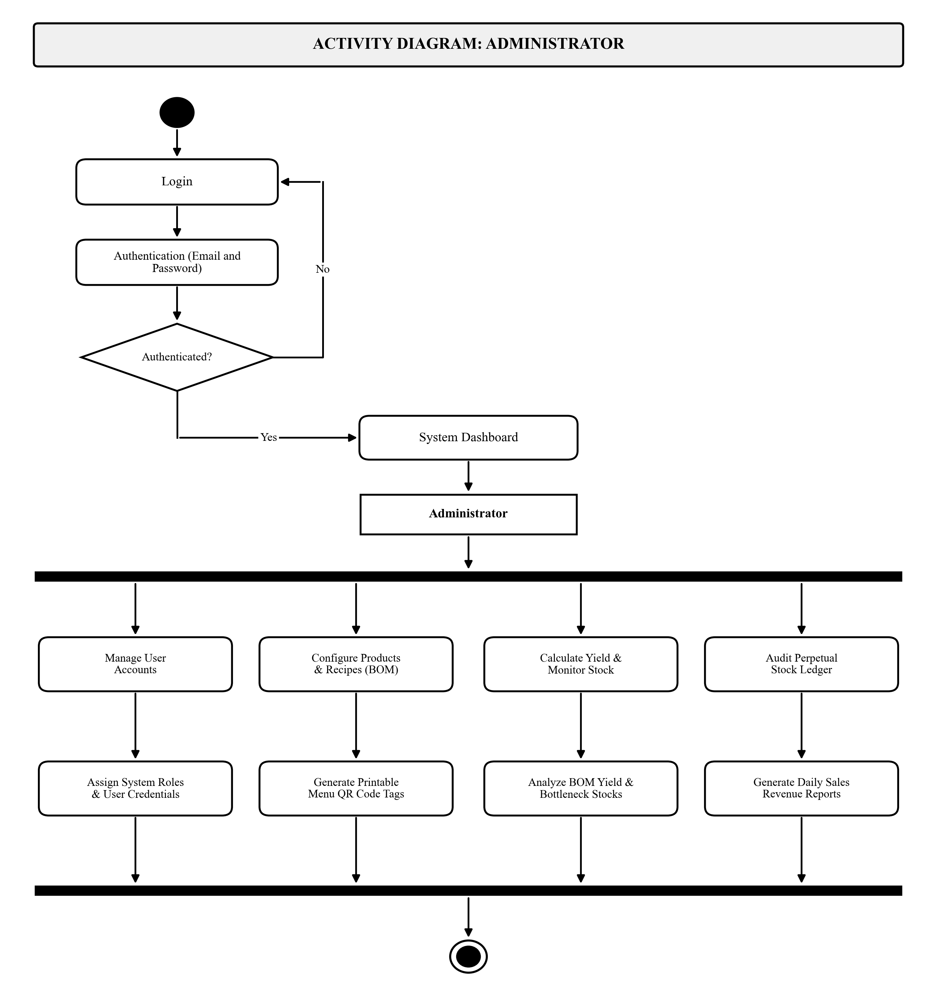
*Figure 5d. Activity Diagram for Administrator Role*

*Class Diagram and Database Schema*

Figure 6 presents the Class Diagram and database schema of the system, comprising eleven interconnected entity classes in MySQL organized into three operational subsystems:

1. Catalog, Recipes, and Inventory Subsystem: categories (menu classifications), products (unique product_code QR tags, names, base prices, availability), inventory_items & recipes (raw ingredients, cup stocks, bill of materials quantity per unit), and product_addons & sizes (extra toppings, milk options, and cup size price tiers).

2. Tables, Reservations, and Stock Ledger Subsystem: dining_tables (table and study pod codes, seating zones, power outlet availability, status), reservations (reservation numbers, unique qr_token hashes, time slots, check-in status), reservation_items (pre-ordered menu items and quantities), and inventory_ledger & txns (immutable audit trail of stock receipts, conversions, and Brew-to-Serve deductions).

3. Users, POS Orders, and Payments Subsystem: users (account credentials, role assignments, student/faculty institutional affiliation), orders (transaction numbers, table references, cashier IDs, order types, subtotal, statutory discount amounts, 12% VAT, net totals, preparation status), order_items (line items, cup sizes, modifiers, unit prices), and payments (order foreign keys, cash tender, change computations, GCash transaction reference codes).

Cardinality relationships (1 to many, 1 to 1, and 0..1 to 1) are strictly enforced via foreign key constraints, with product foreign key references linking products directly to order line items.

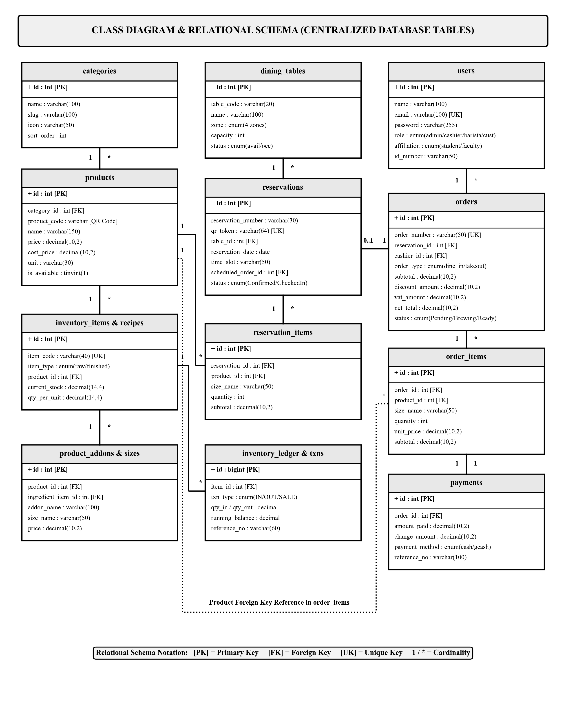
*Figure 6. Class Diagram and Entity-Relationship Schema of the System*

*Sequence Diagrams*

To capture the chronological, message-based interactions between users, user interfaces, application controllers, and the database, UML Sequence Diagrams were created separately for each user role. Each diagram details the lifelines, activation bars, synchronous request messages, and dashed return messages that govern transactions.

Figure 7a illustrates the Sequence Diagram for the Customer role, tracing interactions across four lifelines: Customer (Actor), Web Portal (Boundary), PHP Server (Control), and Database (Entity). The customer authenticates and accesses the dashboard (Messages 1–5). In the reservation phase (Messages 6–12), the customer selects a table and pre-orders, which the server persists in the database and renders as a dynamic QR booking pass with scheduled preparation timing. Finally, the customer monitors live order fulfillment status updates (Messages 13–16).

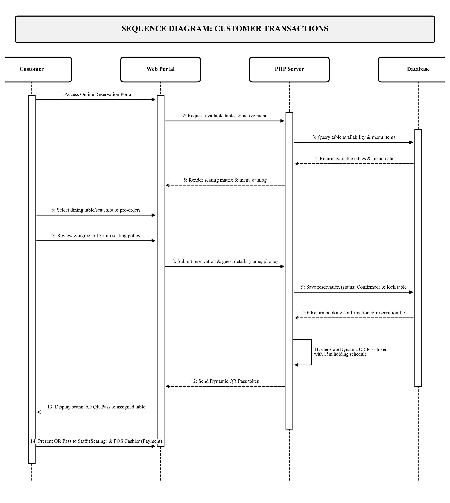
*Figure 7a. Sequence Diagram for Customer Role*

Figure 7b illustrates the Sequence Diagram for the Cashier role across five lifelines: Cashier (Actor), POS Terminal (Boundary), PHP Server (Control), Database (Entity), and Customer (Actor). After authentication (Messages 1–5), the cashier scans product QR codes or customer QR booking passes (Messages 6–11), prompting the server to retrieve item data, check packaging stock, and compute statutory discounts. The customer tenders cash or GCash payment (Messages 12–18), whereupon the transaction is committed to the database, dispatching the order to the kitchen and generating a printed thermal sales receipt.

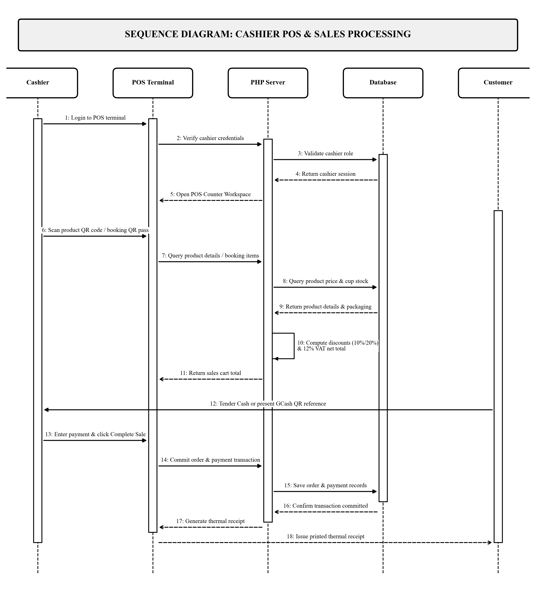
*Figure 7b. Sequence Diagram for Cashier Role*

Figure 7c illustrates the Sequence Diagram for the Barista role across five lifelines: Barista (Actor), KDS Screen (Boundary), PHP Server (Control), Database (Entity), and Customer (Actor). The barista opens the KDS screen, which queries pending orders from the database and displays incoming tickets (Messages 1–5). The barista updates ticket status to Brewing (Messages 6–9), and upon completion marks the order as Ready and Served (Messages 10–16). This triggers the automated Brew-to-Serve routine to deduct ingredients and cups in the database and log inventory movements, concluding with drink service at the pickup counter.

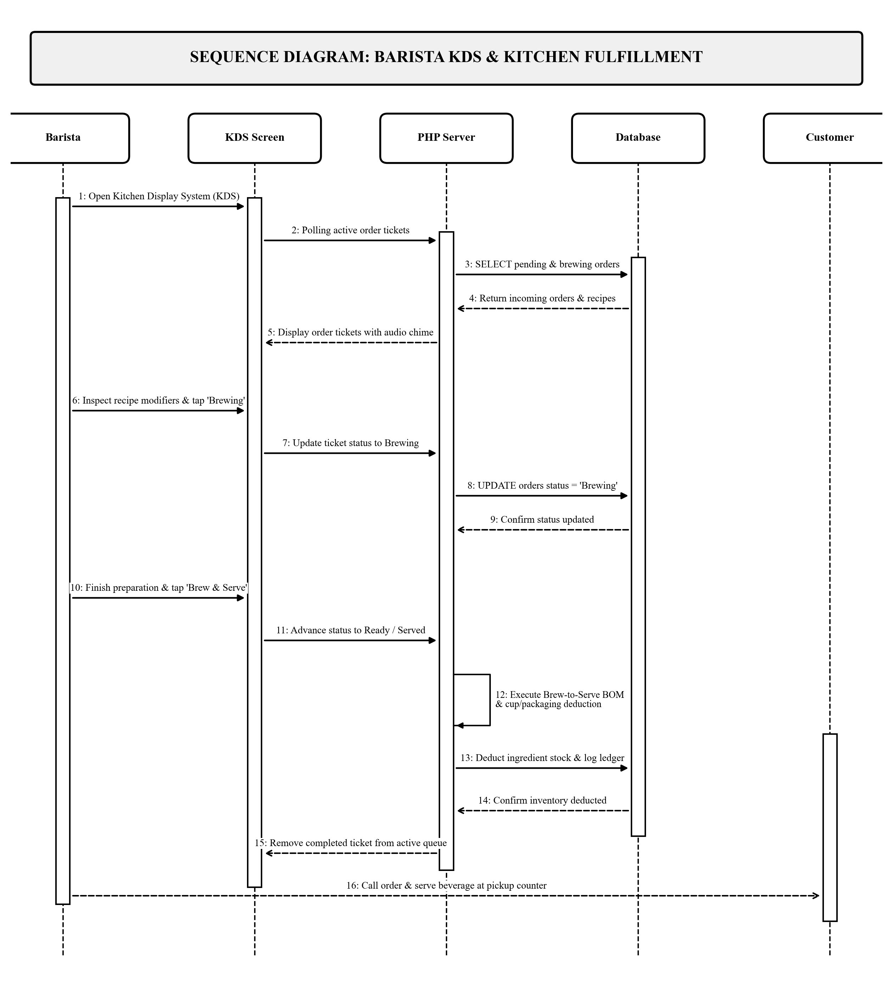
*Figure 7c. Sequence Diagram for Barista Role*

Figure 7d illustrates the Sequence Diagram for the Administrator role across four lifelines: Administrator (Actor), Admin Console (Boundary), PHP Server (Control), and Database (Entity). Following administrative authentication (Messages 1–5), the administrator configures product details and recipes to generate printable 2D QR tags (Messages 6–11). The administrator queries perpetual inventory stock balances and audit ledgers (Messages 12–15), and generates comprehensive daily sales reports with computed VAT breakdowns (Messages 16–18).

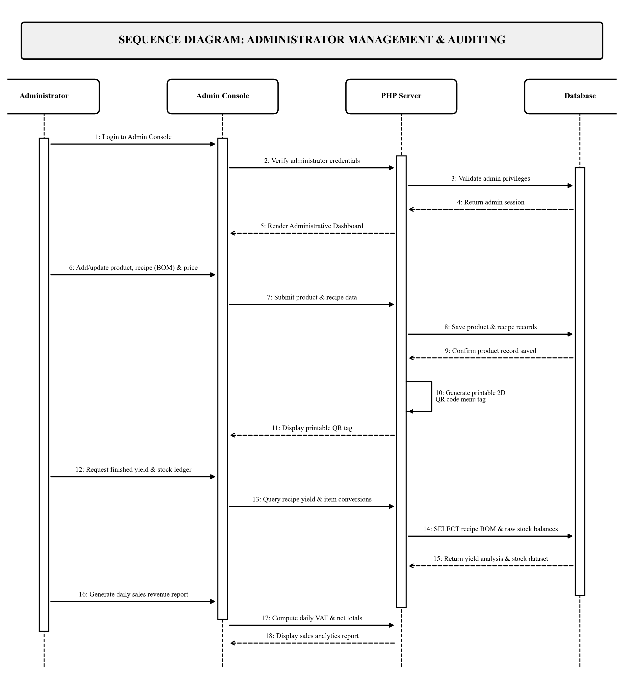
*Figure 7d. Sequence Diagram for Administrator Role*

### Requirement Analysis

*Hardware Requirements*

Table 2. *Minimum Hardware Requirements*

| Hardware Component | Minimum Required Specification |
| --- | --- |
| Server Host Machine | Intel Core i5 / AMD Ryzen 5 processor, 8 GB RAM, 256 GB SSD, Gigabit Ethernet interface |
| Cashier POS Station | Touchscreen All-in-One Desktop PC / Laptop (Intel Core i3 / 8 GB RAM) running Windows 10/11 |
| Optical Barcode Scanner | 2D Omnidirectional Optical QR / Barcode Scanner (USB / Wireless handheld) |
| POS Receipt Printer | Direct Thermal POS Receipt Printer with ESC/POS emulation (USB / Serial interface) |
| Barista KDS Display | 10.1-inch or larger Tablet / Wall-Mounted LCD Monitor running modern web browser |
| Customer Client Devices | Smartphones, tablets, or laptops supporting modern web browsers (Chrome, Safari, Firefox, Edge) |
| Networking Equipment | Dual-band Wi-Fi 5 / 6 Router and Gigabit Ethernet Switch providing stable campus LAN connectivity |

*Software Requirements*

Table 3. *Required Software Specifications*

| Software Component | Required Specification / Tool |
| --- | --- |
| Operating System | Microsoft Windows 10 or 11 (64-bit) / Linux |
| Web Server | Apache Web Server (XAMPP / Hostinger) |
| Programming Language | PHP 8.x (Native PHP / PDO) |
| Database Engine | MySQL Community Server |
| Frontend Design | HTML5, Bootstrap 5.3, JavaScript, Chart.js |
| Web Browser | Google Chrome, Mozilla Firefox, or Microsoft Edge |
| Development Tool | Visual Studio Code, Git |

### System Evaluation (ISO/IEC 25010)

Table 4. *5-Point Likert Scale and Interpretation Range*

| Rating | Range | Interpretation |
| --- | --- | --- |
| 5 | 4.21 - 5.00 | Excellent |
| 4 | 3.41 - 4.20 | Very Good |
| 3 | 2.61 - 3.40 | Good |
| 2 | 1.81 - 2.60 | Poor |
| 1 | 1.00 - 1.80 | Very Poor |

### Data Gathering and Statistical Treatment

A total of ten (10) respondents were selected using purposive sampling to evaluate the system. Purposive sampling ensured that evaluators possessed relevant technical expertise and familiarity with campus auxiliary services. The evaluators were categorized into two distinct panels:

1. IT Experts (5 respondents): Information Technology faculty members and software engineers from ISAT U - DC who rigorously evaluated system architectural design, database normalization, barcode auto-read responsiveness, security enforcement, and source code maintainability.

2. Domain End-Users (5 respondents): ISAT U - DC auxiliary services staff, prospective coffee shop cashiers, student assistants, and faculty and student patrons who evaluated interface usability, study pod reservation clarity, order customization, and overall operational readiness.

$$\text{Mean} = \frac{\sum \text{Ratings}}{\text{Number of Respondents}}$$

Table 5. *Summary of ISO 25010 Software Quality Evaluation Results*

| ISO/IEC 25010 Quality Characteristic | Computed Mean | Interpretation |
| --- | --- | --- |
| 1. Functional Suitability | 4.70 | Excellent |
| 2. Performance Efficiency | 4.60 | Excellent |
| 3. Compatibility | 4.55 | Excellent |
| 4. Usability | 4.65 | Excellent |
| 5. Reliability | 4.60 | Excellent |
| 6. Security | 4.55 | Excellent |
| 7. Maintainability | 4.65 | Excellent |
| 8. Portability | 4.60 | Excellent |
| Overall Grand Mean | 4.62 | Excellent |

Table 5 shows the summary of the evaluation results. All eight characteristics received mean scores above 4.21, resulting in an Overall Grand Mean of 4.62, which is interpreted as Excellent.

Functional Suitability achieved the highest evaluation score at 4.70. Evaluators highlighted that the system thoroughly fulfills the operational requirements for establishing the ISAT U - DC Coffee Shop from the ground up, particularly praising the optical QR code auto-read capability, the visual study pod reservation map, and the paperless barista screen. Usability and Maintainability each received a rating of 4.65, demonstrating that prospective counter staff found the touch interface intuitive to navigate, while IT experts validated the modularity and clean architecture of the Native PHP and MySQL codebase. Performance Efficiency and Reliability both achieved 4.60, confirming rapid transactional response times and error-free cart and discount calculations. Security (4.55), Compatibility (4.55), and Portability (4.60) demonstrated that role-based access control and local LAN web access performed reliably across multiple devices. In summary, the evaluation results confirm that developing the system from the ground up equips the forthcoming ISAT U - DC Coffee Shop with an outstanding, dependable, and production-ready operational management platform.
