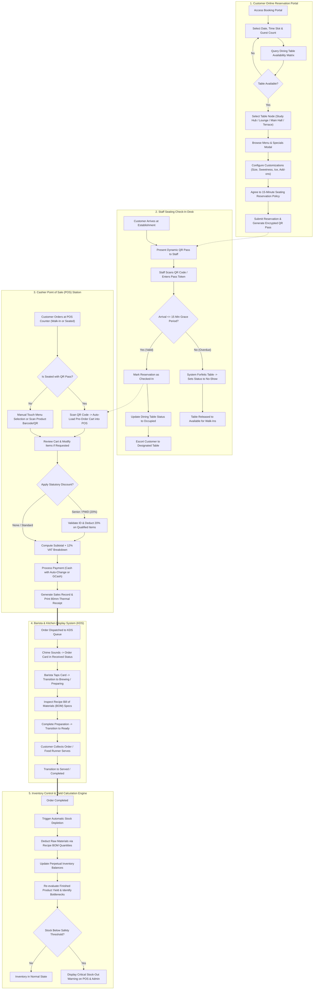
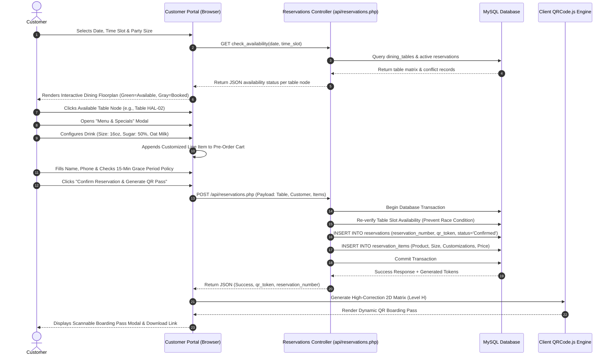
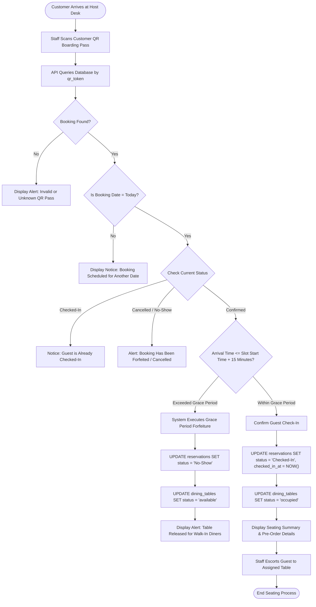
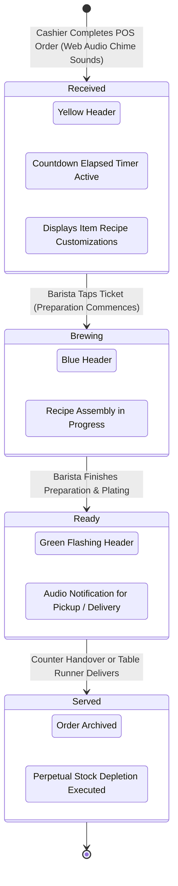
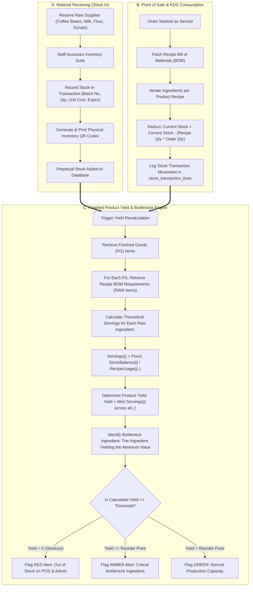
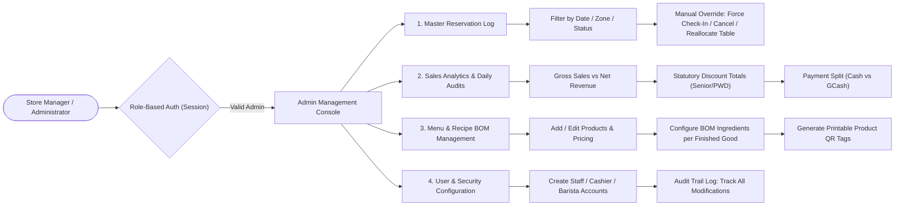
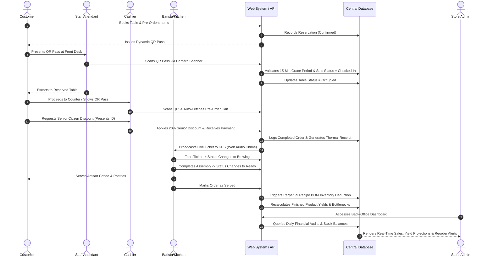

# System Process Flow & Operational Architecture
## Raeden’s Resto, Bakery, Cafe: Point of Sale with Online Table Reservation, QR-Code Seating Pass, Kitchen Display System (KDS), and Recipe BOM Inventory Management

---

## 1. Executive Overview & System Operational Framework

The **Raeden’s Resto, Bakery, Cafe Management System** is a unified, multi-role web-based platform engineered to automate and synchronize the operational touchpoints of a commercial food service, artisan bakery, and specialty coffee establishment. The architecture addresses the acute inefficiencies of traditional manual workflows—specifically paper chit loss, seating misallocation, manual statutory discount computation, and speculative visual inventory tracking.

The system synchronizes five core operational roles:
1. **Customer (Public/Diner):** Self-service visual table selection, modalized menu browsing, pre-ordering, and cryptographic dynamic QR boarding pass generation.
2. **Staff (Front Desk & Floor Attendant):** Optical QR code verification, rapid customer seating, manual reservation overrides, and automated enforcement of the **15-Minute Seating Grace Period Policy**.
3. **Cashier (Point of Sale Station):** One-tap QR pre-order fetching, physical product barcode/QR scanning, item modifier customizations, automated 20% statutory Senior/PWD discounting, payment tender recording, and thermal receipt issuance.
4. **Kitchen Staff & Barista (Kitchen Display System):** Paperless real-time preparation queue, acoustic arrival alerts, recipe Bill of Materials (BOM) guidance, and order lifecycle state transitions (`Received` $\to$ `Brewing` $\to$ `Ready` $\to$ `Served`).
5. **Admin & Store Manager (Back-Office Hub):** Perpetual stock tracking, stock-in receiving, recipe BOM formulation, **Finished Product Yield Calculation with Bottleneck Ingredient Analysis**, sales auditing, and system user management.

---

## 2. High-Level End-to-End System Flowchart

The following high-level diagram visualizes the holistic operational progression, from a customer’s online table booking and pre-ordering to floor check-in, cashier payment, kitchen fulfillment, and automated inventory deduction.

---

## 3. Detailed Modular Process Flows

### 3.1 Module 1: Customer Online Reservation & Pre-Ordering Process Flow

The customer reservation portal enables diners to secure seating and optionally pre-order artisan dishes and specialty beverages prior to arrival.

#### Operational Steps:
1. **Time Slot & Party Verification:** The customer selects a target booking date, time slot (e.g., `10:00 AM - 12:00 PM`, `01:00 PM - 03:00 PM`), and party size.
2. **Dynamic Seating Conflict Trapping:** The system performs an asynchronous `GET` query to `/api/reservations.php?action=check_availability` passing the chosen date and slot. Tables currently flagged as `maintenance`, `occupied`, or reserved by an existing confirmed reservation during the exact time slot are visually disabled and trapped from selection.
3. **Table Node Allocation:** The diner selects an available table across four themed dining zones:
   - **Study Hub:** Quiet study pods with individual electrical outlets (`POD-01`, `POD-02`, `POD-03`).
   - **Lounge:** Plush sofa arrangements for casual gatherings (`LNG-01`, `LNG-02`).
   - **Main Hall:** Central family and group dining tables (`HAL-01`, `HAL-02`).
   - **Outdoor Terrace:** Open-air patio seating (`TER-01`, `TER-02`).
4. **Modalized Menu & Customization Browser:** The user opens the **Menu & Specials Modal** (`#menuSpecialsModal`). A sticky mobile navigation toolbar allows live filtering by category and keyword search. Tapping **"Customize & Add"** opens the item modifier modal:
   - **Cup Size Selection:** Regular (12oz), Large (16oz), Jumbo (22oz) with incremental price recalculation.
   - **Sweetness Tuning:** 0%, 25%, 50%, 75%, 100%.
   - **Ice Levels:** Hot, Less Ice, Regular Ice, Extra Ice.
   - **Add-on Modifiers:** Extra Espresso Shot, Oat Milk Substitution, Flavored Syrups, Coffee Jelly.
5. **Seating Policy Acknowledgment:** Before submission, the diner must check the required checkbox consenting to the **15-Minute Seating Reservation Policy**.
6. **Token Cryptography & QR Generation:** The server validates input data, issues a unique tracking code (`RES-YYYYMMDD-XXX`) and high-entropy alphanumeric QR token (`ISATU-RES-XXXXXXXXXXXX-XXXX`), saves the booking into `reservations` and `reservation_items`, and returns the dynamic scannable QR Pass.

---

### 3.2 Module 2: Staff Seating Check-In & Table Management Flow

The Staff Station governs physical customer arrivals, seating enforcement, and the execution of the 15-minute table release rule.

#### Input-Process-Output (IPO) Analysis for Seating Desk:
| Stage | Description / Elements |
| :--- | :--- |
| **Input** | Optical 2D QR Code video stream from camera scanner, or manual pass token entry (`ISATU-RES-XXXXXXXXXXXX-XXXX`). |
| **Process** | Query reservation record; compare system timestamp (`Asia/Manila` +08:00) against scheduled `time_slot`; evaluate 15-minute threshold; update database state atomically. |
| **Output** | Green check-in modal with guest name, table badge, and pre-ordered dishes; table status updated to `occupied`; or automatic table release alert if grace period expired. |

---

### 3.3 Module 3: Cashier Point of Sale (POS) & Billing Process Flow

The Cashier POS Station handles walk-in orders, table billing, optical QR pre-order fetching, statutory discount deductions, multi-tender transactions, and receipt printing.

```mermaid
flowchart TD
    A(["Order Intake at POS Counter"]) --> B{"Order Method?"}
    
    B -- "Pre-Ordered via QR Pass" --> C1["Cashier Scans Customer QR Pass"]
    C1 --> C2["API Fetches Pending Pre-Order Items"]
    C2 --> C3["Cart Auto-Populated with Reserved Table & Customized Items"]
    
    B -- "Walk-In / Counter Order" --> D1["Cashier Selects Order Type (Dine-In Table / Takeout)"]
    D1 --> D2["Touchscreen Menu Catalog or Optical Product Barcode Scan"]
    D2 --> D3["Configure Modifiers (Size, Ice, Sugar, Add-ons)"]
    D3 --> D4["Add Items to Active POS Register Cart"]
    
    C3 --> E["Review Cart Items & Quantities"]
    D4 --> E
    
    E --> F{"Customer Requests Statutory Discount?"}
    F -- "Yes (Senior Citizen / PWD)" --> G1["Select Discount Type: Senior / PWD (20%)"]
    G1 --> G2["Enter Government ID / PWD Booklet Number"]
    G2 --> G3["Apply Formula: Net Due = Subtotal - (Eligible Subtotal * 0.20)"]
    
    F -- "No / Standard" --> G4["Discount = 0.00; Net Due = Subtotal"]
    
    G3 --> H["Calculate Statutory 12% VAT Breakdown"]
    G4 --> H
    
    H --> I["Proceed to Tender / Payment Modal"]
    I --> J{"Select Payment Method"}
    
    J -- "Cash Payment" --> K1["Enter Cash Tendered Amount"]
    K1 --> K2["Compute Change = Cash Tendered - Net Due"]
    K2 --> K3{"Cash Tendered >= Net Due?"}
    K3 -- "No" --> K1
    K3 -- "Yes" --> L["Record Transaction in Database"]
    
    J -- "GCash Payment" --> M1["Customer Scans Store QR Ph / Sends Payment"]
    M1 --> M2["Cashier Enters 13-Digit GCash Reference Number"]
    M2 --> L
    
    L --> N["INSERT INTO orders (order_number, cashier_id, net_total, payment_method)"]
    N --> O["INSERT INTO order_items (Recipe Line Breakdown)"]
    O --> P["INSERT INTO payments (amount_tendered, amount_change, reference)"]
    P --> Q["Broadcast Order Event to Kitchen Display System (KDS)"]
    Q --> R["Trigger Thermal Printer (80mm ESC/POS Receipt Output)"]
    R --> S(["Transaction Finished"])
```

#### Statutory Discount Calculation Formula:
For transactions claiming Republic Act No. 9994 (Expanded Senior Citizens Act) or Republic Act No. 10754 (An Act Expanding the Benefits of Persons with Disability):
$$\text{Discount Amount} = \sum_{k \in \text{Qualified Items}} (\text{Price}_k \times \text{Quantity}_k) \times 0.20$$
$$\text{Net Amount Due} = \text{Total Gross Subtotal} - \text{Discount Amount}$$
$$\text{VAT-Exempt Sales} = \text{Net Amount Due}$$
$$\text{Change} = \text{Amount Tendered} - \text{Net Amount Due}$$

---

### 3.4 Module 4: Barista & Kitchen Display System (KDS) Process Flow

The paperless KDS screen coordinates kitchen preparation, tracks order lead times, and enforces standard recipe assembly.

#### Detailed KDS State Transitions:
1. **`Received` (Pending):** When the cashier confirms payment, an order event is recorded. The ticket appears with a bright amber header, displaying the customer’s name, table designation, elapsed timer, and line items with explicit customization directives (e.g., *"16oz Iced Caramel Macchiato: 25% Sugar, Oat Milk, +1 Espresso Shot"*). An audible web audio chime alerts kitchen staff.
2. **`Brewing` (In Progress):** The barista taps the order card to acknowledge receipt. The header turns cobalt blue. Kitchen attendants reference the recipe Bill of Materials (BOM) to assemble food and beverage orders to precise proportions.
3. **`Ready` (Awaiting Collection):** Upon completion, the barista taps **"Mark as Ready"**. The card transitions to vibrant emerald green, signaling front-of-house floor staff or the customer for service.
4. **`Served` (Completed):** When handed to the customer or placed on the dining table, the ticket is archived into historical logs. This completion event triggers the inventory management engine to calculate perpetual stock deduction.

---

### 3.5 Module 5: Finished Product Yield Calculator & Perpetual Inventory Flow

The perpetual inventory subsystem automates recipe ingredient tracking, tracks raw material levels, and forecasts the maximum quantity of finished food and drinks the kitchen can prepare.

#### Mathematical Formulation of the Finished Product Yield Calculator:
Let:
- $P_i$ be the $i$-th finished good menu item (e.g., *Golden Tamaraw Latte*).
- $B(P_i) = \{ (R_{i,1}, u_{i,1}), (R_{i,2}, u_{i,2}), \dots, (R_{i,m}, u_{i,m}) \}$ be the recipe Bill of Materials (BOM) for product $P_i$, where $R_{i,j}$ represents the $j$-th raw material ingredient and $u_{i,j}$ denotes the required usage quantity per serving.
- $S(R_{i,j})$ be the current available stock balance of raw ingredient $R_{i,j}$ in perpetual storage.

The maximum **Finished Product Yield** $Y(P_i)$ represents the integer number of complete servings producible from available supplies:
$$Y(P_i) = \min_{j \in B(P_i)} \left\lfloor \frac{S(R_{i,j})}{u_{i,j}} \right\rfloor$$

The **Bottleneck Ingredient** $R^*_i$ is formally defined as the specific raw material constraining the yield:
$$R^*_i = \arg\min_{R_{i,j} \in B(P_i)} \left\lfloor \frac{S(R_{i,j})}{u_{i,j}} \right\rfloor$$

---

### 3.6 Module 6: Administrative Oversight, Audit, and Security Process Flow

The Administrative Dashboard consolidates management controls into a unified back-office view.

---

## 4. Multi-Role Interaction Sequence (Swimlane Architecture)

The sequence diagram below models the cross-functional communication and data flow across all human actors and system subsystems for a complete dining lifecycle.

---

## 5. System Exception & Edge Case Handling Matrix

To ensure field reliability during peak dining operations, the system enforces automated exception controls:

| Operational Scenario | Potential System Hazard | Architectural Countermeasure / Resolution |
| :--- | :--- | :--- |
| **Simultaneous Table Selection** | Two customers click the same table node simultaneously. | **Database Transaction Lock:** An atomic check verifies slot availability at the exact instant of submission; the second transaction fails gracefully with a user-friendly alert: *"Table just booked by another diner. Please choose another table."* |
| **No-Show Customer** | Customer reserves a table during peak hours but fails to appear. | **15-Minute Grace Period Automation:** If arrival time exceeds `reservation_time + 15 minutes`, the check-in scanner refuses the pass, changes status to `No-Show`, and restores the table to `available` for walk-in guests. |
| **Unlinked Pre-Order Billing** | Cashier manual billing creates double entries. | **Single-Fetch Token Trapping:** When a QR pre-order is loaded into the POS register, its reference token is linked to the order. Once checked out, the token cannot be re-fetched. |
| **Ingredient Stockout During Shift** | Barista runs out of milk mid-shift after an order is placed. | **Real-Time Bottleneck Warning:** The Yield Calculator tracks raw stocks perpetually. When stock hits zero, the POS product card is automatically greyed out with an *"Out of Stock"* badge, disabling additions. |
| **Hardware / Network Disconnection** | Internet drops on local café router. | **Local Fallback Architecture:** The system runs natively on local Apache/MySQL (`localhost/CMS`) with graceful offline degradation; cached receipts can be reprinted from order history. |
| **Statutory Discount Fraud** | Non-qualified discounts applied without oversight. | **Mandatory ID Recording & Audit Trail:** The POS register enforces the input of a government Senior/PWD ID number before unlocking the 20% discount calculation, saving the ID directly into the sales audit record. |

---

## 6. Synthesis for Manuscript Chapter 3 Integration

This document corresponds directly to the academic methodologies required in **Chapter 3 (System Design and Methodology)** of the research manuscript:
1. **Flowcharts (Section 3.x Operational Flowchart):** The diagrams in Section 2, Section 3, and Section 4 provide the academic visualizations for the operational workflows of all system roles.
2. **Formula Documentation:** The mathematical expressions for **Statutory Discounting** (Section 3.3) and the **Finished Product Yield Calculator with Bottleneck Analysis** (Section 3.5) align with the mathematical formulations in the research design.
3. **Data Integrity & Traceability:** The transactional sequences demonstrate full relational database integrity, foreign key cascading, and non-destructive historical sales preservation.
